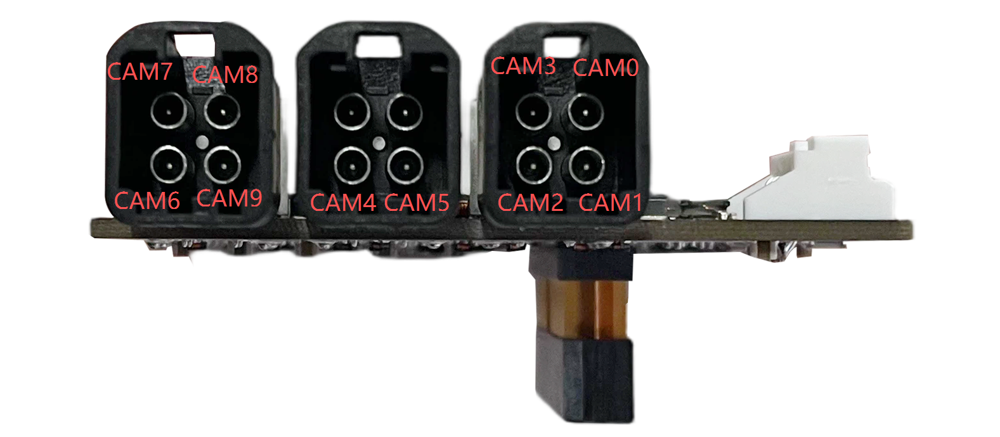
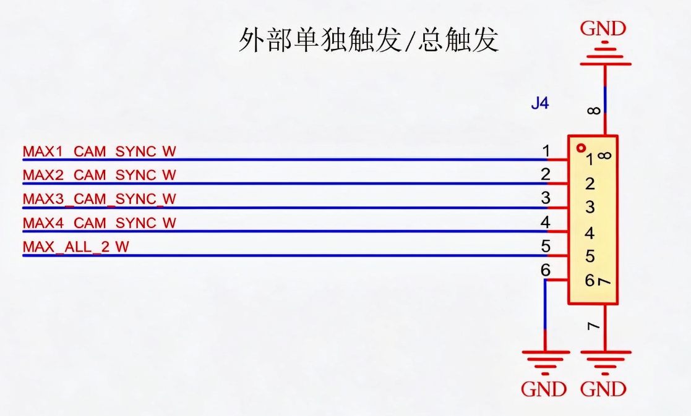

#### Jetpack version

* Jetpack 7.2

#### Supported Camera

```
Camera Model                   Camera Type                 Resolution  frame_rate    Data Format      GMSL2 Rate      Trigger Pin     MaxDevices
SG2-AR0233C-5200-G2A-Hxxx       Monocular                 1920*1080U    30fps           UYVY            6Gbps          mfp7              10                 
SG3S11AFSK                      Monocular                 1920*1536U    30fps           UYVY            3Gbps          mfp7              10
SHF3L                           Monocular                 1920*1536U    30fps           UYVY            6Gbps          mfp7              10
SHW3H                           Monocular                 1920*1536U    60fps           UYVY            6Gbps          mfp7              8
SG8-OX08DC-5300-G2G-Hxxx        Monocular                 3840*2160U    30fps           UYVY            6Gbps          mfp7              8
S56C                             Stereo                   2560*1984U    30fps           RAW10           6Gbps          mfp7              5
SHW5G                           Monocular                 2560*1984U    30fps           RAW10           6Gbps          mfp7              10
SHW3G                           Monocular                 2064*1552U    30fps           RAW12           6Gbps        mfp7、mfp3          9
```
Note: The SHW3G cannot be connected simultaneously with the SHW5G or S56C. Video nodes under the same Deserializer cannot mix 3G and 6G modes.
#### Quick Bring Up

1. Connect the Camera to the ports on the adapter board.

   1.1 Mapping of hardware ports to /dev/video nodes

    The mapping between physical CAM ports and their corresponding /dev/video device nodes is illustrated below:
     
    
    ```
    PORT                       DEV NODE      Deserializer               
    CAM0                     /dev/video0          1       
    CAM1                     /dev/video1          1       
    CAM2                     /dev/video2          2      
    CAM3                     /dev/video3          2       
    CAM4                     /dev/video4          3       
    CAM5                     /dev/video5          3       
    CAM6                     /dev/video6          4       
    CAM7                     /dev/video7          4
    CAM8                     /dev/video8          4       
    CAM9                     /dev/video9          4                              
    ```
    Note: Stereo camera needs an even port (CAM0/2/4/6/8) and the next port must be free.

   1.2 Power Supply

   SG10A_AGON_G2M_A4 adapt board need to be powered by 12V.
 

2. Copy the driver package to the working directory of the Jetson device, such as “/home/nvidia”

   ```
   /home/nvidia/SG10A_AGON_G2M_A4_AGX_ORIN_GMSL2x10_JP7.2_L4TR39.2
   ```
3. Select camera for cam_0~cam_9

   Enter the driver directory, run the script "generate_camera_overlay.py" to select camera.

   ```
   cd SG10A_AGON_G2M_A4_AGX_ORIN_GMSL2x10_JP7.2_L4TR39.2
   python3 generate_camera_overlay.py
   ```

   for example
   ```   
   nvidia@nvidia:~/SG10A_AGON_G2M_A4_AGX_ORIN_GMSL2x10_JP7.2_L4TR39.2$ python3 generate_camera_overlay.py
   Available models:
   0: shw3g (raw12)
   1: sgx-yuv-gmsl2 (uyvy)
   2: shw5g (raw10)
   3: s56c (raw10)

   Select camera for cam_0 (0-3): 3
   Placed stereo pair 's56c' on cam_0 and cam_1.
   Select camera for cam_2 (0-3): 1
   Select camera for cam_3 (0-3): 1
   Select camera for cam_4 (0-3): 1
   Select camera for cam_5 (0-3): 1
   Select camera for cam_6 (0-3): 3
   Placed stereo pair 's56c' on cam_6 and cam_7.
   Select camera for cam_8 (0-3): 1
   Select camera for cam_9 (0-3): 1

   Selected configurations:
   cam_0@1b -> s56c
   cam_1@1c -> s56c
   cam_2@1b -> sgx-yuv-gmsl2
   cam_3@1c -> sgx-yuv-gmsl2
   cam_4@1b -> sgx-yuv-gmsl2
   cam_5@1c -> sgx-yuv-gmsl2
   cam_6@1b -> s56c
   cam_7@1c -> s56c
   cam_8@1d -> sgx-yuv-gmsl2
   cam_9@1e -> sgx-yuv-gmsl2

   Found cam_0@1b
   Found cam_1@1c
   Found cam_2@1b
   Found cam_3@1c
   Found cam_4@1b
   Found cam_5@1c
   Found cam_6@1b
   Found cam_7@1c
   Found cam_8@1d
   Found cam_9@1e

   Generated: dts/tegra234-camera-sgcamx10-overlay.dts
   Compiling...
   Generated: dts/tegra234-camera-sgcamx10-overlay.dtbo

   --- Final Port Configuration ---
   Port 0 (cam_0@1b): s56c (raw10)
   Port 1 (cam_1@1c): s56c (raw10)
   Port 2 (cam_2@1b): sgx-yuv-gmsl2 (uyvy)
   Port 3 (cam_3@1c): sgx-yuv-gmsl2 (uyvy)
   Port 4 (cam_4@1b): sgx-yuv-gmsl2 (uyvy)
   Port 5 (cam_5@1c): sgx-yuv-gmsl2 (uyvy)
   Port 6 (cam_6@1b): s56c (raw10)
   Port 7 (cam_7@1c): s56c (raw10)
   Port 8 (cam_8@1d): sgx-yuv-gmsl2 (uyvy)
   Port 9 (cam_9@1e): sgx-yuv-gmsl2 (uyvy)
   --- End of Configuration ---
   ```
   
   After execution, a new DTB file is generated:
   

   dts/tegra234-camera-sgcamx10-overlay.dtbo
4. Enter the driver directory, run the script "install.sh"

   ```
   cd SG10A_AGON_G2M_A4_AGX_ORIN_GMSL2x10_JP7.2_L4TR39.2
   chmod a+x ./install.sh
   ./install.sh
   ```

   
5. Use the "sudo /opt/nvidia/jetson-io/jetson-io.py" command to select the corresponding device.

   ```
   sudo /opt/nvidia/jetson-io/jetson-io.py

   1.select "Configure Jetson AGX CSI Connector"
   2.select "Configure for compatible hardware"
   3.select "Jetson Sensing SG10A_AGON_G2M_A4 SGCAM_GMSL2x10"
   4.select "Save pin changes"
   5.select "Save and reboot to reconfigure pins"
   ```
6. Edit the load_modules.sh script and execute it.

   6.1 After reboot,Modify the video device configuration command lines.

   The following commands are used to configure the cameras recognized as video0 to video9 in the system.
   ```
   v4l2-ctl -d /dev/video0 -c sensor_mode=0,gmsl_mode=0,trig_pin=0x00050007,trig_mode=0
   v4l2-ctl -d /dev/video1 -c sensor_mode=2,gmsl_mode=0,trig_pin=0x00050007,trig_mode=0
   v4l2-ctl -d /dev/video2 -c sensor_mode=2,gmsl_mode=0,trig_pin=0x00050007,trig_mode=0
   v4l2-ctl -d /dev/video3 -c sensor_mode=2,gmsl_mode=0,trig_pin=0x00050007,trig_mode=0
   v4l2-ctl -d /dev/video4 -c sensor_mode=2,gmsl_mode=1,trig_pin=0x00050007,trig_mode=0
   v4l2-ctl -d /dev/video5 -c sensor_mode=2,gmsl_mode=1,trig_pin=0x00050007,trig_mode=0
   v4l2-ctl -d /dev/video6 -c sensor_mode=2,gmsl_mode=0,trig_pin=0x00020007,trig_mode=0
   v4l2-ctl -d /dev/video7 -c sensor_mode=2,gmsl_mode=0,trig_pin=0x00020007,trig_mode=0
   v4l2-ctl -d /dev/video8 -c sensor_mode=2,gmsl_mode=0,trig_pin=0x00020007,trig_mode=0
   v4l2-ctl -d /dev/video9 -c sensor_mode=2,gmsl_mode=0,trig_pin=0x00020007,trig_mode=0
   ```
   You need to adjust the command parameters sensor_mode, gmsl_mode, trig_mode, and trig_pin according to the camera model and the connection used. Here, sensor_mode specifies the camera resolution, gmsl_mode specifies whether the camera operates at 6Gbps or 3Gbps, while trig_mode and trig_pin denote the trigger mode and the corresponding trigger pin to be utilized, respectively.

   
   ```
   # sensor_mode:
   For YUV  Camera:
   1920*1080：sensor_mode=1,1920*1536：sensor_mode=2,2880*1860:sensor_mode=3,3840*2160：sensor_mode=4;
   For RAW  Camera：sensor_mode=0.

   # gmsl_mode:
   gmsl_mode=0:6Gbps, gmsl_mode=1:3Gbps(only SG3S11AFSK).
    
   # trig_pin:(0x00050007:DES Trigger Pin MPF5,SER Trigger Pin MFP7),trig_mode:(0/2)
   For MASTER Mode (camera auto-triggers after activation; only one rising-edge trigger is provided) 
   MAX9296(video0~5):trig_pin=0x00050007,trig_mode=0
   MAX96712(video6~9):trig_pin=0x00020007,trig_mode=0
   
   For Internal Trigger:(The cameras are triggered and synchronized through the trigger signal generated from the Jetson Orin or MCU)
   For SHW3G：
   MAX9296(video0~5):trig_pin=0x000a0007,trig_mode=2
   MAX96712(video6~9):trig_pin=0x000b0007,trig_mode=2
   For other cameras：
   MAX9296(video0~5):trig_pin=0x00050007,trig_mode=2
   MAX96712(video6~9):trig_pin=0x00020007,trig_mode=2

   For External-Trigger mode (The cameras are synchronously triggered via the trigger signal generated by the external signal generator that is connected to the trigger Pin of the Kit):
   For SHW3G：
   MAX9296(video0~5):trig_pin=0x00090007,trig_mode=2
   MAX96712(video6~9):trig_pin=0x000a0007,trig_mode=2
   For other cameras：
   individual triggers:
   MAX9296(video0~5):trig_pin=0x00050007,trig_mode=2
   MAX96712(video6~9):trig_pin=0x00020007,trig_mode=2

   global trigger:
   MAX9296(video0~5):trig_pin=0x00090007,trig_mode=2
   MAX96712(video6~9):trig_pin=0x000a0007,trig_mode=2
   ```
   Note: For SHW3G triggering, the driver has already enabled MAX9296 MFP5 and MAX96712 MFP2 to pass through XVS by default. You only need to select which pin to pass through the XHS signal. For internal trigger (provided by MCU), select MFP10/MFP11 accordingly; for external trigger (provided by signal generator), select MFP9/MFP10 accordingly.

   6.2 Run the script "load_module.sh".
   ```
   sudo ./load_modules.sh
   ```
   After the module is loaded, the device nodes /dev/video0~video9 will be generated.

7. Camera Trigger Sync 

   7.1 Internal Trigger(trigger signal generated by Jetson Orin)
   
   ```
   sudo insmod /ko/pwm-gpios.ko

   # Export PWM channel 0
   echo 0 > /sys/class/pwm/pwmchip5/export

   # Set the period to 33333333 (corresponding to 30 Hz)
   echo 33333333 > /sys/class/pwm/pwmchip5/pwm0/period

   # Set the duty cycle
   echo 3333333 > /sys/class/pwm/pwmchip5/pwm0/duty_cycle

   # Enable PWM output
   echo 1 > /sys/class/pwm/pwmchip5/pwm0/enable
   ```
   Note: MCU firmware flashing is required to generate the IMX900 XHS signal. The signal will be output after flashing firmware to SG10A_AGON_G2M_A4.

   7.2 External Trigger Mode

   External Trigger Port: J4
   
   
   
   MAX*_CAM_SYNC_W, where * ranges from 1 to 4, corresponds to the individual trigger pins of Deserializer 1–4, respectively. MAX_ALL_2 is the common trigger pin for Deserializer 1–4. Please select the appropriate pin to connect based on the actual Deserializer in use and the trigger mode.
   
   for SHW3G:
   ```
   MAX*_CAM_SYNC_W Pin Trigger Signal Parameters:
   Frequency: 30 Hz
   Amplitude: 3.3V
   Bias: 1.6V
   Duty Cycle: 10%

   MAX_ALL_2_W Pin Trigger Signal Parameters:
   Frequency: 83 kHz
   Amplitude: 3.3V
   Bias: 1.6V
   Duty Cycle: 90%
   PIN 6: GND
   ```
   
   for all other cameras:
   ```
   # individual triggers
   MAX*_CAM_SYNC_W Pin Trigger Signal Parameters:
   Frequency: 30 Hz
   Amplitude: 3.3V
   Bias: 1.6V
   Duty Cycle: 10%
   PIN 6: GND

   #  global trigger:
   MAX_ALL_2_W Pin Trigger Signal Parameters:
   Frequency: 30 Hz
   Amplitude: 3.3V
   Bias: 1.6V
   Duty Cycle: 10%
   PIN 6: GND
   ```

  

8. Bring up cameras

   8.1 Bring up the  YUV camera
   
   ```
   ## Video0
   gst-launch-1.0 v4l2src device=/dev/video0 ! xvimagesink -ev

   ## Video1
   gst-launch-1.0 v4l2src device=/dev/video1 ! xvimagesink -ev

   ## Video2
   gst-launch-1.0 v4l2src device=/dev/video2 ! xvimagesink -ev

   ## Video3
   gst-launch-1.0 v4l2src device=/dev/video3 ! xvimagesink -ev

   ## Video4
   gst-launch-1.0 v4l2src device=/dev/video4 ! xvimagesink -ev

   ## Video5
   gst-launch-1.0 v4l2src device=/dev/video5 ! xvimagesink -ev

   ## Video6
   gst-launch-1.0 v4l2src device=/dev/video6 ! xvimagesink -ev

   ## Video7
   gst-launch-1.0 v4l2src device=/dev/video7 ! xvimagesink -ev

   ## Video8
   gst-launch-1.0 v4l2src device=/dev/video8 ! xvimagesink -ev

   ## Video9
   gst-launch-1.0 v4l2src device=/dev/video9 ! xvimagesink -ev

   ```

   8.2 Install argus_camera
   ```
   sudo apt-get install nvidia-l4t-jetson-multimedia-api
   ```
   After installation, the jetson_multimedia_api folder can be found in the /usr/src directory. Then refer to the documentation /usr/src/jetson_multimedia_api/argus/README.TXT to install argus_camera.
   

   8.3 Bring up the  RAW camera
   Start nvargus-daemon in a terminal
   ```
   #for shw5g and s56c
   sudo service nvargus-daemon stop
   export NVCAMERA_NITO_PATH=/var/nvidia/nvcam/settings/shw5g.nito
   sudo -E enableCamInfiniteTimeout=1 nvargus-daemon

   #for shw3g
   sudo service nvargus-daemon stop
   export NVCAMERA_NITO_PATH=/var/nvidia/nvcam/settings/shw3g.nito
   sudo -E enableCamInfiniteTimeout=1 nvargus-daemon
   ```
   Start argus_camera in another terminal
   ```
   ## Video0
   argus_camera -d 0

   ## Video1
   argus_camera -d 1

   ## Video2
   argus_camera -d 2

   ## Video3
   argus_camera -d 3

   ## Video4
   argus_camera -d 4

   ## Video5
   argus_camera -d 5

   ## Video6
   argus_camera -d 6

   ## Video7
   argus_camera -d 7

   ## Video8
   argus_camera -d 8

   ## Video9
   argus_camera -d 9
   ```
 
8. IMU Testing 
   
      Only for S56C Camera.

     The IMU driver operates in polling mode.

      ```
      sudo rmmod bmi088  >/dev/null 2>&1
      sudo rmmod kfifo_buf  >/dev/null 2>&1
      sudo insmod ko/kfifo_buf.ko
      sudo insmod ko/bmi088.ko
      cd sample/bmi088/
      make clean && make
      ```

      Accelerometer Sample Output
      ```
      sudo ./iio_generic_buffer -a -c 10 --device-name accelerometer -g
      ```

      Gyroscope Sample Output
      ```
      sudo ./iio_generic_buffer -a -c 10 --device-name gyroscope -g
      ```
